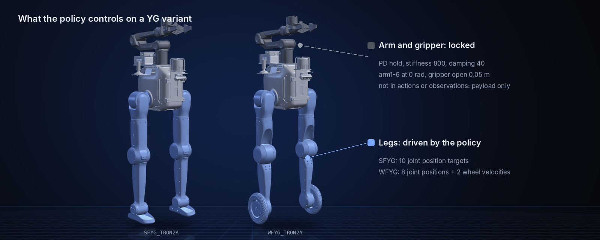

<!--
  SPDX-FileCopyrightText: 2026 LimX Dynamics Technology Co., Ltd.
  SPDX-License-Identifier: Apache-2.0
-->

<p align="center">
  
</p>

<p align="center">
  <a href="README.md">English</a> | <a href="README_cn.md">中文</a>
</p>

<p align="center">
  <a href="LICENCE"></a>
  
  
  
</p>

# TRON2_YG_LAB

Reinforcement learning training stack for the LimX **TRON2A** biped, built on [Isaac Lab](https://isaac-sim.github.io/IsaacLab/) with PPO. It trains blind locomotion policies for the **SF** (sole-foot) and **WF** (wheel-foot) bases, and for the **SFYG / WFYG** variants that carry a 6-DoF arm and a two-finger gripper. Built for the ATEC challenge.

> **Scope:** blind (no perception) velocity tracking on flat and rough terrain (no stairs). Trained policies are not included: you train them here and export TorchScript / ONNX.

## Highlights

- **Four robots, one stack.** SF, WF, SFYG and WFYG each register a Flat and a Rough training task plus matching `-Play-v0` tasks (16 task IDs).
- **Arm as payload.** In SFYG / WFYG a dedicated PD group holds the arm and gripper in a fixed pose, so the policy learns to walk with the extra mass without the arm entering the action or observation space.
- **Rough terrain with curriculum.** Procedural flat / waves / boxes / random-rough terrain on a 10×16 grid, difficulty 0→1.
- **Velocity estimator built in.** An MLP encoder reads 10 steps of observation history and estimates base velocity for the actor.
- **Deployment-ready export.** `play.py` writes TorchScript and ONNX files for the policy and the encoder into `exported/` next to the checkpoint.

## Model lineup

| | Model | Description | Task ID prefix |
|:---:|---|---|---|
|  | **SF_TRON2A** | Biped with sole feet (ankle pitch). | `Isaac-Limx-SF-TRON2A-...` |
|  | **WF_TRON2A** | Biped with wheel feet. | `Isaac-Limx-WF-TRON2A-...` |
|  | **SFYG_TRON2A** | Sole-foot base + 6-DoF arm + two-finger gripper (locked). | `Isaac-Limx-SFYG-TRON2A-...` |
|  | **WFYG_TRON2A** | Wheel-foot base + 6-DoF arm + two-finger gripper (locked). | `Isaac-Limx-WFYG-TRON2A-...` |

Images are rendered in MuJoCo from the bundled `robot_description` models in the initial pose used for training (arm at zero, gripper fully open).

## Quick start

**Look at the robots** (no Isaac Sim needed):

```bash
git clone --recurse-submodules https://github.com/limxdynamics/TRON2_YG_LAB.git
cd TRON2_YG_LAB
pip install mujoco
python -m mujoco.viewer --mjcf=robot_description/tron2/SFYG_TRON2A/xml/robot.xml
```

Swap `SFYG_TRON2A` for `SF_TRON2A`, `WF_TRON2A` or `WFYG_TRON2A`.

**Train a policy** (Isaac Sim 4.5.0 + Isaac Lab installed, see [Installation](#installation)):

```bash
python scripts/rsl_rl/train.py --task Isaac-Limx-SFYG-TRON2A-Blind-Rough-v0 --num_envs 4096 --headless
```

## Repository structure

```
.
├── exts/bipedal_locomotion/   # Isaac Lab extension: env / asset / MDP / robot configs
├── rsl_rl/                    # Vendored rsl_rl fork (PPO, on-policy runner, MLP encoder); train.py puts it first on sys.path
├── scripts/rsl_rl/            # Entry points train.py / play.py / cli_args.py (scripts, not a package)
├── robot_description/         # Git submodule: URDF / USD / MJCF / meshes for TRON2
└── doc/                       # README images
```

## Installation

Requires Isaac Sim **4.5.0** + Isaac Lab (`isaaclab` / `isaaclab_tasks` / `isaaclab_rl` importable), Python 3.10 and an NVIDIA GPU (≥ 12 GB VRAM recommended for 4096 environments). Clone as in [Quick start](#quick-start), then:

```bash
git submodule update --init --recursive   # only if cloned without --recurse-submodules
pip install -e exts/bipedal_locomotion
pip install -e rsl_rl
```

The USD files in the `robot_description` submodule are loaded when training or play starts; without them, spawning the robot fails.

## Training

```bash
python scripts/rsl_rl/train.py --task <TASK> --num_envs 4096 --headless
```

`<TASK>` is `Isaac-Limx-{SF,WF,SFYG,WFYG}-TRON2A-Blind-{Flat,Rough}-v0`, registered in [robots/__init__.py](exts/bipedal_locomotion/bipedal_locomotion/tasks/locomotion/robots/__init__.py). **Flat** is a plain plane; **Rough** uses `BLIND_ROUGH_TERRAINS_CFG` in [cfg/SF_TRON2A/terrains_cfg.py](exts/bipedal_locomotion/bipedal_locomotion/tasks/locomotion/cfg/SF_TRON2A/terrains_cfg.py) and [cfg/WF_TRON2A/terrains_cfg.py](exts/bipedal_locomotion/bipedal_locomotion/tasks/locomotion/cfg/WF_TRON2A/terrains_cfg.py), which YG variants reuse.

Common options:

- `--video --video_interval 24000 --video_length 400` — record videos (auto-enables `--enable_cameras`)
- `--max_iterations N` — override the maximum iteration count in the PPO cfg

Logs go to `logs/rsl_rl/<experiment_name>/<timestamp>_<run_name>/`.

### Resume training

Pass `--resume True` explicitly; `agent_cfg.resume` defaults to `False` ([train.py:130-139](scripts/rsl_rl/train.py#L130-L139)).

```bash
python scripts/rsl_rl/train.py --task <TASK> --num_envs 4096 --headless --resume True \
    --checkpoint_path logs/rsl_rl/<experiment_name>/<timestamp>_<run_name>/model_<iter>.pt
```

Or replace `--checkpoint_path` with `--load_run <run_dir> --checkpoint <model_file>`; both accept regex (e.g. `--load_run ".*"`) and pick the latest match under `logs/rsl_rl/<experiment_name>/` in lexicographic order.

- Use the same task ID as the original run, or loading fails on obs/action dimensions; changing reward weights is fine. Logs go to a new timestamped directory.
- `--max_iterations` is a cap, not an increment: trained to 1500 and want 1000 more → `--max_iterations 2500`.

## Play and export

Use the `-Play-v0` task ID. Play cfg uses fewer envs, disables domain randomization and simplifies terrain.

```bash
python scripts/rsl_rl/play.py --task Isaac-Limx-SF-TRON2A-Blind-Rough-Play-v0 --num_envs 32 \
    --checkpoint_path logs/rsl_rl/sf_tron_2a_rough/<run>/model_<iter>.pt
```

`play.py` also writes TorchScript and ONNX (`policy.onnx`, `encoder.onnx`) to `exported/` next to the checkpoint.

## YG Variant Design

<p align="center">
  
</p>

The arms remain locked in a fixed pose throughout (arm1~6 = 0 rad, gripper1/2 = 0.05 m), held by a dedicated `arm_lock` `ImplicitActuator` group (stiffness 800, damping 40) in the asset config performing PD lock.

- Arm joints are **not** in `joint_order_name`, so the policy neither commands nor observes them: the arm is payload only.
- Domain randomization, reset and the dof_limits reward exclude arm joints in the YG env cfg, so they neither disturb the lock PD nor add spurious penalties.

For the full arm exclusion checklist, see [exts/bipedal_locomotion/bipedal_locomotion/tasks/locomotion/robots/limx_solefoot_yg_tron2a_env_cfg.py](exts/bipedal_locomotion/bipedal_locomotion/tasks/locomotion/robots/limx_solefoot_yg_tron2a_env_cfg.py) and [limx_wheelfoot_yg_tron2a_env_cfg.py](exts/bipedal_locomotion/bipedal_locomotion/tasks/locomotion/robots/limx_wheelfoot_yg_tron2a_env_cfg.py).

## Task wiring

How a task ID is wired up, using `Isaac-Limx-SF-TRON2A-Blind-Flat-v0` as an example:

1. **`gym.register`**: `tasks/locomotion/robots/__init__.py` binds (env_cfg, ppo_cfg) to the task ID
2. **Env cfg**: `tasks/locomotion/robots/limx_solefoot_tron2a_env_cfg.py` inherits from `tasks/locomotion/cfg/SF_TRON2A/limx_base_env_cfg.py::SF_TRON2A_EnvCfg`, attaches assets + modifies MDP
3. **MDP terms**: `tasks/locomotion/mdp/{rewards,events,observations,curriculums,commands}.py`
4. **PPO cfg**: `tasks/locomotion/agents/limx_rsl_rl_ppo_cfg.py`, using the project's custom `RslRlPpoAlgorithmMlpCfg` type (not the upstream class)
5. **Asset cfg**: `assets/config/<robot>_cfg.py`, spawns USD (from `robot_description/`) + init joint pos + actuators

To add a new robot variant: increment one copy at each of the 5 layers above without modifying the existing TRON2 training stack.

## Submodule: robot_description

The robot models come from [tron2-robot-description](https://github.com/limxdynamics/tron2-robot-description) (URDF / xacro / MuJoCo XML / meshes / USD for the TRON2 variants). This repository pins it at commit `8a11c12`, where the models live under `tron2/<MODEL>/`.

> **Do not update the submodule to the latest `main`.** Later versions of tron2-robot-description moved the models to `tron2a/<MODEL>/`, so the asset configs in `exts/bipedal_locomotion/bipedal_locomotion/assets/config/` would no longer find the USD files. Update the submodule only together with those paths.

## Related repositories

| Repository | Description |
|---|---|
| [tron2_rl_lab](https://github.com/limxdynamics/tron2_rl_lab) | Isaac Lab RL for SF / WF and the full-body dual-arm DASF_TRON2A |
| [tron2_mujoco_sim](https://github.com/limxdynamics/tron2_mujoco_sim) | MuJoCo simulator for sim-to-sim checks |
| [tron2_rl_deploy_python](https://github.com/limxdynamics/tron2_rl_deploy_python) · [tron2_rl_deploy_ros](https://github.com/limxdynamics/tron2_rl_deploy_ros) | Policy deployment in Python / ROS |

## License

[Apache 2.0](LICENCE).
