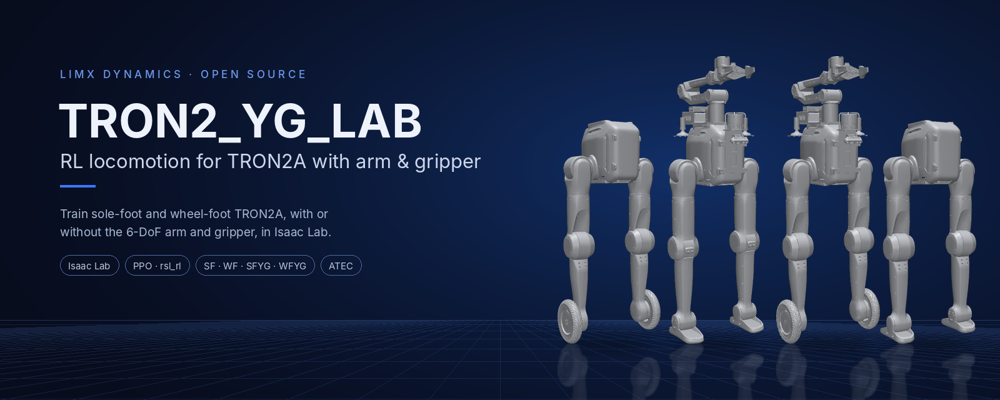
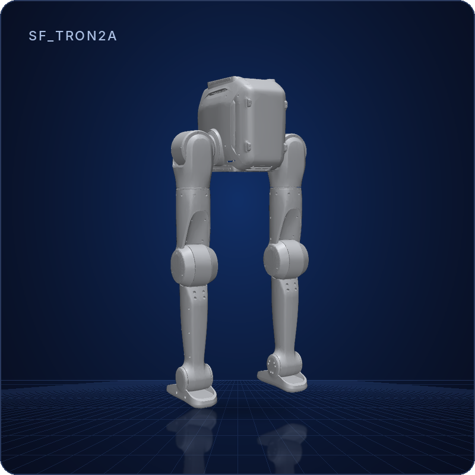
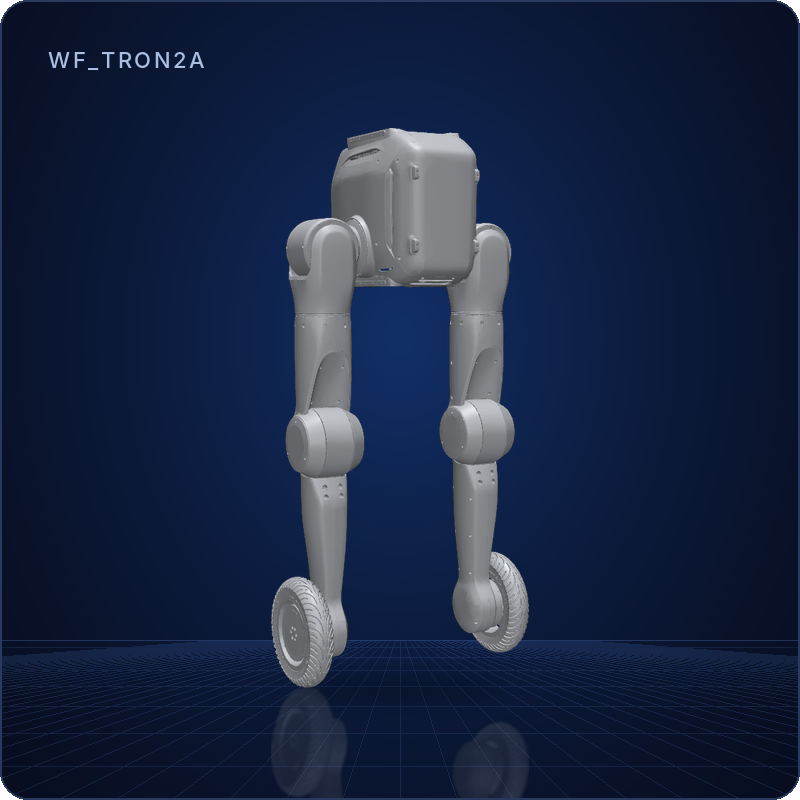
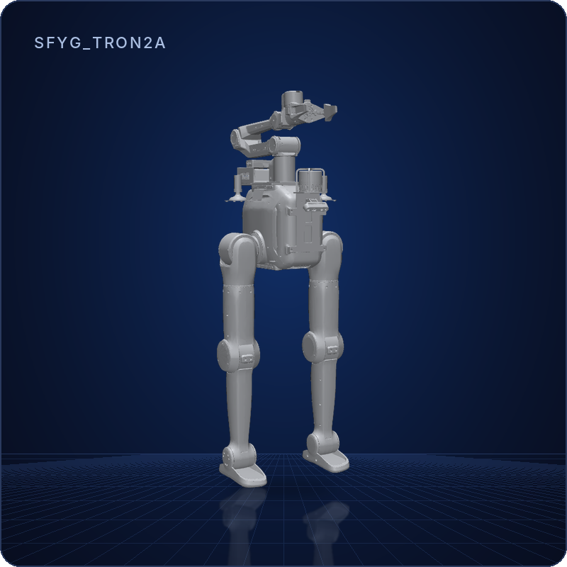
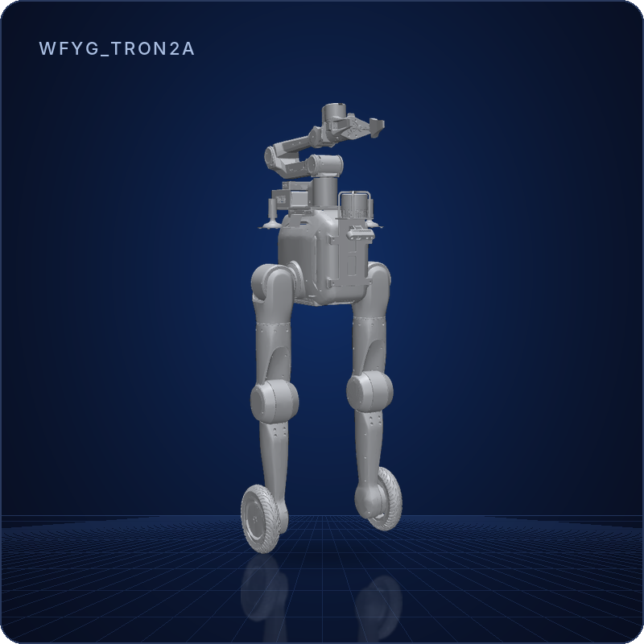
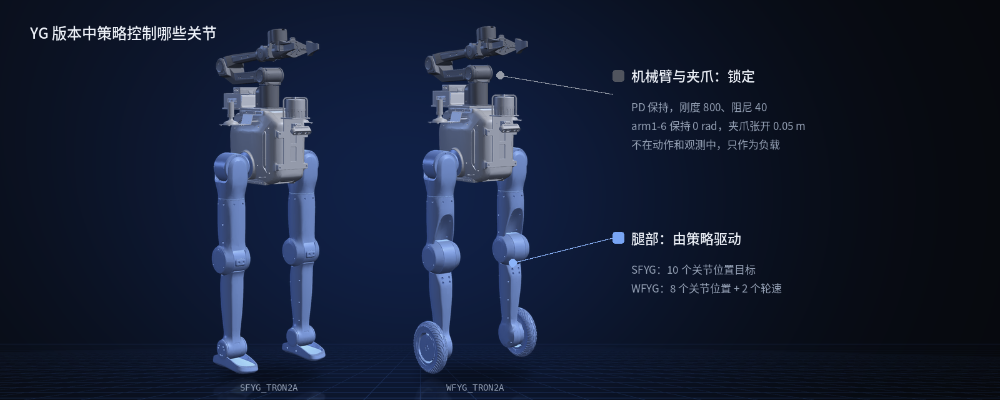

<!--
  SPDX-FileCopyrightText: 2026 LimX Dynamics Technology Co., Ltd.
  SPDX-License-Identifier: Apache-2.0
-->

<p align="center">
  
</p>

<p align="center">
  <a href="README.md">English</a> | <a href="README_cn.md">中文</a>
</p>

<p align="center">
  <a href="LICENCE"></a>
  
  
  
</p>

# TRON2_YG_LAB

基于 [Isaac Lab](https://isaac-sim.github.io/IsaacLab/) 的 LimX **TRON2A** 双足机器人强化学习训练栈，使用 PPO 训练盲走（无感知）运动策略。支持 **SF**（足板）和 **WF**（轮足）两种底座，以及带 6 自由度机械臂和双指夹爪的 **SFYG / WFYG** 形态。为 ATEC 挑战赛开发。

> **适用范围：** 平地和起伏地形（不含楼梯）上的速度跟踪，不使用感知。YG 形态中机械臂和夹爪锁定，作为负载携带，不由策略控制。仓库不附带训练好的策略：在这里训练，再导出 TorchScript / ONNX 用于部署。

## 亮点

- **一套代码，四种机型。** SF、WF、SFYG、WFYG 各自注册 Flat 和 Rough 训练任务以及对应的 `-Play-v0` 任务，共 16 个任务 ID。
- **机械臂作为负载。** SFYG / WFYG 中，机械臂和夹爪由单独的 PD 组锁定在固定姿态，策略学会带着额外重量行走，机械臂不进入动作空间和观测。
- **带课程的起伏地形。** 程序生成 flat / waves / boxes / random_rough 四类子地形，10×16 网格，难度 0→1。
- **内置速度估计器。** MLP 编码器读取最近 10 步观测历史，为 actor 估计机身速度。
- **可直接部署的导出。** `play.py` 会把策略和编码器的 TorchScript、ONNX 文件导出到 checkpoint 旁边的 `exported/` 目录。

## 机型一览

| | 机型 | 说明 | 任务 ID 前缀 |
|:---:|---|---|---|
|  | **SF_TRON2A** | 足板双足（带踝关节俯仰）。 | `Isaac-Limx-SF-TRON2A-...` |
|  | **WF_TRON2A** | 轮足双足。 | `Isaac-Limx-WF-TRON2A-...` |
|  | **SFYG_TRON2A** | 足板底座 + 6 自由度机械臂 + 双指夹爪（锁定）。 | `Isaac-Limx-SFYG-TRON2A-...` |
|  | **WFYG_TRON2A** | 轮足底座 + 6 自由度机械臂 + 双指夹爪（锁定）。 | `Isaac-Limx-WFYG-TRON2A-...` |

图片由 `robot_description` 中的模型在 MuJoCo 里渲染，采用训练时的初始姿态（机械臂零位、夹爪全开）。

## 快速开始

**先看看机器人**（不需要 Isaac Sim）：

```bash
git clone --recurse-submodules https://github.com/limxdynamics/TRON2_YG_LAB.git
cd TRON2_YG_LAB
pip install mujoco
python -m mujoco.viewer --mjcf=robot_description/tron2/SFYG_TRON2A/xml/robot.xml
```

把 `SFYG_TRON2A` 换成 `SF_TRON2A`、`WF_TRON2A` 或 `WFYG_TRON2A` 即可查看其他机型。

**训练策略**（已安装 Isaac Sim 4.5.0 + Isaac Lab，见[安装](#安装)）：

```bash
python scripts/rsl_rl/train.py --task Isaac-Limx-SFYG-TRON2A-Blind-Rough-v0 --num_envs 4096 --headless
```

## 仓库结构

```
.
├── exts/bipedal_locomotion/   # Isaac Lab extension：env / asset / MDP / robot 配置
├── rsl_rl/                    # 项目内 vendored 的 rsl_rl fork（PPO + on-policy runner + MLP 编码器）
├── scripts/rsl_rl/            # 入口：train.py / play.py / cli_args.py
├── robot_description/         # git 子模块：TRON2 的 URDF / USD / MJCF / 网格
└── doc/                       # README 图片
```

## 环境要求

- Isaac Sim **4.5.0** + Isaac Lab，且 `isaaclab` / `isaaclab_tasks` / `isaaclab_rl` 可被 import
- Python 3.10
- NVIDIA 显卡（4096 个环境并行训练建议 ≥ 12 GB 显存）

## 安装

```bash
# 1. 连同子模块一起 clone
git clone --recurse-submodules https://github.com/limxdynamics/TRON2_YG_LAB.git
cd TRON2_YG_LAB
# 如果 clone 时没有拉子模块：
git submodule update --init --recursive

# 2. 以可编辑模式安装 extension 和 vendored 的 rsl_rl
pip install -e exts/bipedal_locomotion
pip install -e rsl_rl
```

训练和 play 启动时会加载 `robot_description` 子模块里的 USD 文件，缺少的话机器人无法生成。

## 训练

任务 ID 均在 [exts/bipedal_locomotion/bipedal_locomotion/tasks/locomotion/robots/__init__.py](exts/bipedal_locomotion/bipedal_locomotion/tasks/locomotion/robots/__init__.py) 中注册。

每种形态都有 **Flat**（纯平面）和 **Rough**（程序生成 rough 地形，含 flat / waves / boxes / random_rough 四类子地形，**不含楼梯**）两个变体。

```bash
# === Flat ===
python scripts/rsl_rl/train.py --task Isaac-Limx-SF-TRON2A-Blind-Flat-v0   --num_envs 4096 --headless
python scripts/rsl_rl/train.py --task Isaac-Limx-WF-TRON2A-Blind-Flat-v0   --num_envs 4096 --headless --max_iterations 5000
python scripts/rsl_rl/train.py --task Isaac-Limx-SFYG-TRON2A-Blind-Flat-v0 --num_envs 4096 --headless
python scripts/rsl_rl/train.py --task Isaac-Limx-WFYG-TRON2A-Blind-Flat-v0 --num_envs 4096 --headless

# === Rough（程序生成地形，无楼梯）===
python scripts/rsl_rl/train.py --task Isaac-Limx-SF-TRON2A-Blind-Rough-v0   --num_envs 4096 --headless
python scripts/rsl_rl/train.py --task Isaac-Limx-WF-TRON2A-Blind-Rough-v0   --num_envs 4096 --headless
python scripts/rsl_rl/train.py --task Isaac-Limx-SFYG-TRON2A-Blind-Rough-v0 --num_envs 4096 --headless
python scripts/rsl_rl/train.py --task Isaac-Limx-WFYG-TRON2A-Blind-Rough-v0 --num_envs 4096 --headless
```

Rough 地形定义见 [cfg/SF_TRON2A/terrains_cfg.py](exts/bipedal_locomotion/bipedal_locomotion/tasks/locomotion/cfg/SF_TRON2A/terrains_cfg.py) / [cfg/WF_TRON2A/terrains_cfg.py](exts/bipedal_locomotion/bipedal_locomotion/tasks/locomotion/cfg/WF_TRON2A/terrains_cfg.py) 中的 `BLIND_ROUGH_TERRAINS_CFG`（10×16 网格、curriculum on、难度 0~1）。YG 变体复用 SF / WF 的 rough 地形，但仍按 [YG 变体设计](#yg-变体设计) 屏蔽 arm/gripper 的随机化与限位惩罚。

常用选项：

- `--checkpoint_path <path>` 从某 .pt 恢复（或在 cfg 中开 `resume=True` + `load_run` / `load_checkpoint`）
- `--video --video_interval 24000 --video_length 400` 录像（自动启用 `--enable_cameras`）
- `--max_iterations N` 覆盖 PPO cfg 中的最大迭代数

日志路径：`logs/rsl_rl/<experiment_name>/<timestamp>_<run_name>/`

## Resume 续训

`agent_cfg.resume` 默认 `False`，**必须显式带 `--resume True`** 才会加载 checkpoint（[scripts/rsl_rl/train.py:130-139](scripts/rsl_rl/train.py#L130-L139)）。两种方式：

### 方式 A：直接给 .pt 路径（推荐）

```bash
python scripts/rsl_rl/train.py \
    --task Isaac-Limx-SFYG-TRON2A-Blind-Rough-v0 \
    --num_envs 4096 --headless \
    --resume True \
    --checkpoint_path logs/rsl_rl/<experiment_name>/<timestamp>_<run_name>/model_<iter>.pt
```

### 方式 B：按 run 名 + checkpoint 名查找

```bash
python scripts/rsl_rl/train.py \
    --task Isaac-Limx-SFYG-TRON2A-Blind-Rough-v0 \
    --num_envs 4096 --headless \
    --resume True \
    --load_run 2026-06-01_12-34-56_sfyg_rough \
    --checkpoint model_1500.pt
```

`--load_run` / `--checkpoint` 支持正则（如 `--load_run ".*"`、`--checkpoint "model_.*\.pt"`），在 `logs/rsl_rl/<experiment_name>/` 下按字典序取最新匹配。

注意事项：

1. **task ID 必须与原 run 一致**，否则 obs/action 维度对不上 load 会失败。只改奖励权重之类**不影响维度**的可以续跑。
2. resume 会在 `logs/rsl_rl/<experiment_name>/` 下**新建一个 timestamp 子目录**写新 log，不覆盖原 run 文件。
3. 想再训 N 个 iter：`--max_iterations` 是**上限不是增量**——原来训到 1500、想再训 1000，传 `--max_iterations 2500`。

## Play 与导出

用 `-Play-v0` 后缀的任务 ID。Play cfg 使用更少 env、关闭域随机化、简化地形。

```bash
# Flat
python scripts/rsl_rl/play.py \
    --task Isaac-Limx-SF-TRON2A-Blind-Flat-Play-v0 \
    --num_envs 32 \
    --checkpoint_path logs/rsl_rl/sf_tron_2a_flat/<run>/model_<iter>.pt

# Rough
python scripts/rsl_rl/play.py \
    --task Isaac-Limx-SF-TRON2A-Blind-Rough-Play-v0 \
    --num_envs 32 \
    --checkpoint_path logs/rsl_rl/sf_tron_2a_flat/<run>/model_<iter>.pt
```

每个训练 task 都有同名的 `-Play-v0` 变体，SF/WF/SFYG/WFYG × Flat/Rough 共 8 个。

`play.py` 还会把加载的 checkpoint 导出到其旁边的 `exported/` 目录：TorchScript 和 ONNX（`policy.onnx`、`encoder.onnx`），用于部署。

## 机器人形态

| 形态 | 末端 | 机械臂 | task id 前缀 |
|---|---|---|---|
| SF_TRON2A | sole foot (ankle pitch) | — | `Isaac-Limx-SF-TRON2A-...` |
| WF_TRON2A | wheel | — | `Isaac-Limx-WF-TRON2A-...` |
| SFYG_TRON2A | sole foot | 6-DoF arm + 2-finger prismatic gripper（锁死） | `Isaac-Limx-SFYG-TRON2A-...` |
| WFYG_TRON2A | wheel | 同上 | `Isaac-Limx-WFYG-TRON2A-...` |

### YG 变体设计

<p align="center">
  
</p>

机械臂全程锁死在固定姿态（arm1~6 = 0 rad，gripper1/2 = 0.05 m），由资产 cfg 中独立的 `arm_lock` `ImplicitActuator` 组（stiffness 800、damping 40）执行 PD 锁位。

- 机械臂关节**不在** `joint_order_name` 中 → 不进入 RL action 空间，不进入 observation 维度
- 域随机化 / reset / dof_limits reward 在 YG env cfg 中均显式排除机械臂，避免扰动锁位 PD 或注入伪 penalty
- 训练 / 推理时机械臂作为「负载」存在，对策略不可见

机械臂排除清单的具体覆盖见 [exts/bipedal_locomotion/bipedal_locomotion/tasks/locomotion/robots/limx_solefoot_yg_tron2a_env_cfg.py](exts/bipedal_locomotion/bipedal_locomotion/tasks/locomotion/robots/limx_solefoot_yg_tron2a_env_cfg.py) 与 [limx_wheelfoot_yg_tron2a_env_cfg.py](exts/bipedal_locomotion/bipedal_locomotion/tasks/locomotion/robots/limx_wheelfoot_yg_tron2a_env_cfg.py)。

## 架构

三个顶层包：

1. **`exts/bipedal_locomotion/`** — Isaac Lab extension。env / asset / MDP / robot cfg 全部在这里
2. **`rsl_rl/`** — vendored fork。`scripts/rsl_rl/train.py` 在 `sys.path` 最前面插入此路径，覆盖系统装的版本；import 是 `from rsl_rl.runner import OnPolicyRunner`（单数 `runner`，不是 upstream 的 `runners`）
3. **`scripts/rsl_rl/`** — 入口脚本。**不是包**，靠 `sys.path` 操作工作，CLI 解析顺序固定：launcher args 必须在 `AppLauncher(args_cli)` 之前注册

### 任务 wiring

以 `Isaac-Limx-SF-TRON2A-Blind-Flat-v0` 为例：

1. **`gym.register`**：`tasks/locomotion/robots/__init__.py` 把 (env_cfg, ppo_cfg) 注册到 task id
2. **Env cfg**：`tasks/locomotion/robots/limx_solefoot_tron2a_env_cfg.py` 继承 `tasks/locomotion/cfg/SF_TRON2A/limx_base_env_cfg.py::SF_TRON2A_EnvCfg`，挂资产 + 改 MDP
3. **MDP terms**：`tasks/locomotion/mdp/{rewards,events,observations,curriculums,commands}.py`
4. **PPO cfg**：`tasks/locomotion/agents/limx_rsl_rl_ppo_cfg.py`，类型是项目封装的 `RslRlPpoAlgorithmMlpCfg`（不是 upstream 类）
5. **资产 cfg**：`assets/config/<robot>_cfg.py`，spawn USD（来自 `robot_description/`）+ init joint pos + actuators

新增机器人变体：在以上 5 层各增量一份，不动现有 TRON2 训练栈。

## 子模块：robot_description

机器人模型来自 [tron2-robot-description](https://github.com/limxdynamics/tron2-robot-description)（TRON2 各形态的 URDF / xacro / MuJoCo XML / 网格 / USD）。本仓库将它固定在提交 `8a11c12`，该版本的模型位于 `tron2/<机型>/`。

> **不要把子模块更新到最新的 `main`。** tron2-robot-description 后续版本把模型目录改成了 `tron2a/<机型>/`，`exts/bipedal_locomotion/bipedal_locomotion/assets/config/` 里的资源配置会找不到 USD 文件。如需更新子模块，要同时修改这些路径。

## 相关仓库

| 仓库 | 说明 |
|---|---|
| [tron2-robot-description](https://github.com/limxdynamics/tron2-robot-description) | TRON2 机器人模型（URDF / MJCF / USD） |
| [tron2_rl_lab](https://github.com/limxdynamics/tron2_rl_lab) | 基于 Isaac Lab 的 SF / WF 及全身双臂 DASF_TRON2A 训练 |
| [tron2_mujoco_sim](https://github.com/limxdynamics/tron2_mujoco_sim) | MuJoCo 仿真，用于 sim-to-sim 验证 |
| [tron2_rl_deploy_python](https://github.com/limxdynamics/tron2_rl_deploy_python) · [tron2_rl_deploy_ros](https://github.com/limxdynamics/tron2_rl_deploy_ros) | Python / ROS 策略部署 |

## License

[Apache 2.0](LICENCE)。如果这个项目对你有帮助，欢迎点个 ⭐，让更多人看到它。
